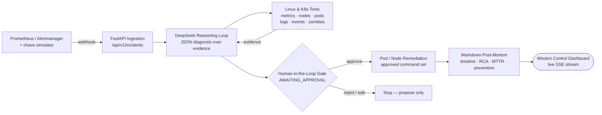

<div align="center">

# KubeAgent

### The Autonomous SRE Agent that detects, diagnoses, and fixes Linux & Kubernetes incidents in under 30 seconds.

[](https://fastapi.tiangolo.com)
[](https://kubernetes.io)
[](https://www.deepseek.com)
[](https://www.kernel.org)
[](https://www.python.org)
[](http://139.84.220.82)
[](LICENSE)
[](https://github.com/Maazkhan96271/KubeAgent)

[Live Demo (Vultr)](http://139.84.220.82) · [Quickstart](#-60-second-quickstart) · [How it works](#-how-it-works) · [Dashboard](#-mission-control-dashboard) · [API](#-api-reference) · [Deploy](#-production-deployment-vultr-kubernetes-engine) · [Security](#-security--safety-model) · [Demo script](DEMO_SCRIPT.md)

</div>

> 🌐 **Live Demo Deployed on Vultr Kubernetes Engine (VKE):** **[http://139.84.220.82](http://139.84.220.82)**  
> *Active Cloud Load Balancer public IP on real VKE cluster `kubeagent-cluster`.*

---

## Why KubeAgent exists

It is 3:04 AM. Your phone is screaming. A pod is OOMKilling in a loop, the dashboard
is a wall of red, and the first thing you do is *not* fix it — you SSH in,
`kubectl describe`, `kubectl logs --previous`, grep a runbook last updated eight
months ago, and hope you remember which env var the last person changed.

KubeAgent collapses that loop into one agentic run: it collects the evidence an
on-call engineer would collect, reasons over it with DeepSeek (or a built-in
heuristic engine when no key is configured), proposes reversible fixes, parks the
incident for human approval, and generates the post-mortem your manager will ask
for on Monday.

**Detection → diagnosis → approval → documentation, in one live event stream.**

---

## What's inside

| Capability | Detail |
| --- | --- |
| **Incident ingestion** | Alertmanager v4 webhooks, custom JSON alerts, manual incident creation, and four deterministic chaos scenarios. Alertmanager duplicates are de-duplicated by fingerprint. |
| **Evidence collection** | 7 typed tools: Kubernetes nodes, unhealthy pods, pod logs, pod warning events; Linux system metrics, top processes, zombie/defunct process census. |
| **Reasoning** | DeepSeek chat-completions JSON diagnosis (summary, root cause, severity, confidence, evidence, actions, commands), with automatic fallback to a deterministic rule engine on any LLM error or missing key. |
| **Human-in-the-loop** | Analysis stops at `AWAITING_APPROVAL`; a signed approval record (who, when, notes, approved actions) is the only way to resolve it. |
| **Live streaming** | Server-Sent Events per incident and across all incidents, with heartbeat pings and reconnect/backoff in the dashboard. |
| **Mission Control UI** | Dark cyberpunk dashboard: chaos injector, alert feed, 5-stage investigation pipeline, live neural-terminal stream, approval banner, post-mortem modal + Markdown download. |
| **Post-mortems** | GitHub-Flavored Markdown (and rendered HTML) with a deterministic report UUID, full timeline, RCA with evidence, remediation table, preventive recommendations and a measured MTTR. |
| **Production packaging** | Two-stage non-root Dockerfile, Docker Compose with healthcheck, raw Kubernetes manifests, a Helm chart, and a Vultr VKE deployment guide. |
| **Portability** | Simulation mode by default — no cluster, kubeconfig or API key needed to run the full pipeline locally. |

---

## Architecture



| Stage | What actually happens in the code |
| --- | --- |
| **Ingestion** | `POST /incidents/webhook` normalises Alertmanager v4 alerts (severity mapped from labels, pod → workload), skips `resolved` alerts and already-open fingerprints. `POST /incidents/simulate` boots a chaos scenario instead. |
| **Evidence** | `AgentOrchestrator.collect_evidence()` runs the read-only tools (unhealthy pods, nodes, host metrics, zombies, plus pod logs and events when a workload is known) in a fixed order, publishing `agent.thought` / `agent.observation` events for each. A failing collector is recorded as evidence, never aborts the run. |
| **Reasoning** | With a key, the evidence and incident are sent to DeepSeek (`deepseek-chat`) in one completion constrained to a JSON object; severity and confidence are clamped and validated. Without a key — or on timeout/parse error — `_rule_based_diagnosis()` selects from OOMKilled, zombie/PID exhaustion, node pressure, config/secret errors, image pull, CPU saturation, crash loop, pending pods, not-ready pods, host memory, host disk. |
| **Approval** | The diagnosis carries `requires_human_approval`; the incident moves to `AWAITING_APPROVAL`. `POST /approve` records `approved_by`, timestamp, notes and the approved command list, then resolves the incident. KubeAgent presents the approved commands; execution stays with your operator or pipeline. |
| **Post-mortem** | `generate_postmortem()` builds Markdown from the stored incident, event log and diagnosis, including MTTR computed from the event timestamps. Served as Markdown or rendered HTML. |
| **Streaming** | `IncidentStore.publish()` fans every event out to per-incident and global subscribers; `EventSourceResponse` delivers them with heartbeat pings and drops slow consumers instead of blocking. |

---

## Problem vs. Solution

| | **Manual on-call at 3 AM** | **KubeAgent** |
| --- | --- | --- |
| **Time to first hypothesis** | 10–20 min of `describe` / `logs` / runbook reading | Seconds — collectors gather evidence in one pass |
| **Context switching** | SSH, three dashboards, a wiki, Slack | One agentic run, one event stream |
| **Diagnosis quality** | Depends on who is on call and how tired they are | Same reasoning path every incident; rule fallback when the LLM is unavailable |
| **Remediation** | Ad-hoc `kubectl delete pod` from memory | Explicit command set, signed approval, full audit trail |
| **Blast radius** | Unbounded — a typo can hit prod | Read-only analysis, approval gate, simulation mode by default |
| **Documentation** | Written days later, if at all | Generated at resolution with a stable report ID |
| **MTTR visibility** | Guessed from chat timestamps | Measured from the incident event log ("0.7 seconds" style) |
| **Repeat incidents** | Same fire drill again | Preventive recommendations matched to the failure signature |

---

## ⚡ 60-Second Quickstart

No cluster, no kubeconfig, no API key. `SIMULATION_MODE=true` is the default, so
the collectors serve a deterministic incident instead of touching a real cluster.

### Option A — one script

```bash
git clone https://github.com/Maazkhan96271/KubeAgent.git && cd KubeAgent && ./run_demo.sh
```

`run_demo.sh` creates `.venv`, installs `requirements.txt`, verifies the app imports,
warns if no LLM key is set, starts uvicorn on port 8000, waits for `/healthz`, then
opens `http://localhost:8000/` in your browser. Override with `PORT=8080 ./run_demo.sh`;
set `DEEPSEEK_API_KEY` (or `LLM_API_KEY`) to enable LLM reasoning.

### Option B — Docker Compose

```bash
docker compose up --build
```

### Option C — manual

```bash
python3 -m venv .venv && .venv/bin/pip install -r requirements.txt
cd backend && ../.venv/bin/uvicorn app.main:app --reload --port 8000
```

You can also run the app module directly — `python -m backend.app.main` from the
repository root, or `python -m app.main` from `backend/`.

### Trigger an incident

Open **http://localhost:8000/** for Mission Control, then from another terminal:

```bash
curl -s -X POST http://localhost:8000/api/v1/incidents/simulate \
  -H 'Content-Type: application/json' \
  -d '{"scenario":"OOMKilled_Payment_Service","auto_analyze":true}' | jq '.incident.id'
```

Watch the terminal stream the investigation, approve the remediation in the amber
banner, then press **View Post-Mortem Report** once the incident flips to `RESOLVED`.

### Enable DeepSeek reasoning

```bash
export DEEPSEEK_API_KEY=sk-...     # or LLM_API_KEY=...
docker compose up --build
```

Without a key the header badge reads **"Heuristic engine · no API key"** and the app
runs the full pipeline with the deterministic rule engine.

### Chaos scenarios

| Scenario ID | Signature |
| --- | --- |
| `OOMKilled_Payment_Service` | Container OOMKilled (exit 137), repeated restarts, heap leak in logs |
| `CrashLoopBackOff_Database_Config` | Missing `DB_PASSWORD` secret key, failing entrypoint, CrashLoopBackOff |
| `Zombie_Process_Leak` | Unreaped children, PID pressure, `fork: Resource temporarily unavailable` |
| `CPU_Spike_Worker_Saturation` | Node CPU saturation, cgroup throttling, liveness probe timeouts |

Aliases are accepted too: `OOMKilled`, `CPU Spike`, `Config Error`, `zombie`.

---

## 🖥 Mission Control dashboard

Served at `/` from `backend/app/templates/index.html` (Jinja2, Tailwind CDN,
Lucide icons, JetBrains Mono).

- **Header** — connection badge (Simulation Mode / Connected / Disconnected), reasoning-engine badge, total pods, active incidents, average-MTTR stat.
- **Chaos Incident Injector** — one click for OOMKill, Zombie CPU Spike or CrashLoopBackOff; the agent is started automatically.
- **Active Alerts** — incident feed with severity, status dots and one-click selection.
- **Approval banner** — appears at `AWAITING_APPROVAL` with the proposed action, **Approve Action** and **Reject**.
- **Agent Investigation Pipeline** — 5 stages: Ingestion → Metric Analysis → Root Cause → Remediation → Verification, driven by SSE events.
- **Neural stream terminal** — colour-coded `agent.thought`, `agent.observation`, `agent.verification`, `diagnosis.completed`, `status` and `error` events, with auto-reconnect and a clear button.
- **Post-mortem** — unlocked when resolved: modal with the rendered report, report ID and **Download .md**.

---

## 🔌 API reference

Base prefix `/api/v1`. Interactive docs at `/docs`, ReDoc at `/redoc`, schema at
`/api/v1/openapi.json`.

| Method | Path | Purpose |
| --- | --- | --- |
| `GET` | `/` | Mission Control dashboard |
| `GET` | `/healthz` | Liveness/readiness probe with mode and engine info |
| `GET` | `/api/v1` | Service metadata and endpoint index |
| `GET` | `/api/v1/cluster/health` | Pod counts, unhealthy pods, active incidents, mode/engine |
| `POST` | `/api/v1/incidents` | Create an incident manually |
| `POST` | `/api/v1/incidents/webhook` | Ingest Alertmanager v4 or custom alerts |
| `POST` | `/api/v1/incidents/simulate` | Trigger a chaos scenario (`auto_analyze` optional) |
| `GET` | `/api/v1/incidents` | List incidents (`?status=`, `?limit=`) |
| `GET` | `/api/v1/incidents/{id}` | Fetch one incident with diagnosis and approval |
| `POST` | `/api/v1/incidents/{id}/analyze` | Run the agent synchronously |
| `POST` | `/api/v1/incidents/{id}/approve` | Human-in-the-loop sign-off |
| `POST` | `/api/v1/incidents/{id}/resolve` | Close an incident manually |
| `GET` | `/api/v1/incidents/{id}/postmortem` | Markdown report (`?format=html` for rendered) |
| `GET` | `/api/v1/incidents/{id}/stream` | SSE stream for one incident |
| `GET` | `/api/v1/stream/incidents` | SSE stream across all incidents |

**Lifecycle:** `OPEN → INVESTIGATING → AWAITING_APPROVAL → RESOLVED` (or straight to
`RESOLVED` when the diagnosis proposes no commands). The store keeps the 50 most
recent incidents and 100 events each.

<details>
<summary><b>Example: Alertmanager webhook</b></summary>

```json
{
  "version": "4",
  "status": "firing",
  "alerts": [
    {
      "status": "firing",
      "labels": {"alertname": "KubePodNotReady", "namespace": "default", "pod": "payment-api-7f9d8c6b5-4xk2p", "severity": "critical"},
      "annotations": {"summary": "Pod payment-api is not ready", "description": "unready for more than 5 minutes"},
      "fingerprint": "a1b2c3d4e5f60718"
    }
  ]
}
```

Response: `{"created": [...], "created_count": 1, "skipped": 0, "message": "..."}`.
Resolved alerts and open duplicates are counted in `skipped`.
</details>

<details>
<summary><b>Example: approval</b></summary>

```bash
curl -X POST http://localhost:8000/api/v1/incidents/<id>/approve \
  -H 'Content-Type: application/json' \
  -d '{"approved_by":"oncall@example.com","notes":"memory bump reviewed"}'
```

Returns the resolved incident with `approval.approved_actions`. A non-pending
incident returns `409`.
</details>

### SSE event types

| Event | Meaning |
| --- | --- |
| `incident.created` | Incident stored and queued for analysis |
| `status` | Lifecycle transition (`INVESTIGATING`, `AWAITING_APPROVAL`, `RESOLVED`) |
| `agent.thought` | Agent about to run a tool / reasoning step |
| `agent.observation` | Tool result, or a collector failure |
| `agent.verification` | Diagnosis ready |
| `diagnosis.completed` | Full diagnosis payload |
| `approval.granted` | Human sign-off with approver and actions |
| `error` | Analysis failed (incident returns to `OPEN`) |
| `ping` | Heartbeat every 15 s |

---

## 📄 Post-mortem reports

`GET /api/v1/incidents/{id}/postmortem` returns `text/markdown` (or `?format=html`
for a standalone dark-themed document). Each report contains:

- header table: severity, status, namespace, workload, source, detected/resolved
  timestamps, **MTTR** and diagnosis confidence;
- executive summary plus a `[!IMPORTANT]` root-cause callout;
- timeline table built from the incident event log, with human-readable phases;
- root-cause analysis with the evidence lines collected from logs and telemetry;
- remediation table (approved vs proposed) and a `[!TIP]` approval record;
- preventive recommendations table matched to the failure signature;
- deterministic report ID derived from the incident, and a generation footer.

The dashboard renders the HTML view in a modal and offers the `.md` download.

---

## ⚙️ Configuration

All settings come from environment variables or a `.env` file (see
[.env.example](.env.example)); names are case-insensitive.

| Variable | Default | Purpose |
| --- | --- | --- |
| `ENVIRONMENT` | `development` | `development` / `staging` / `production` |
| `DEBUG` | `false` | FastAPI debug mode |
| `HOST` / `PORT` | `0.0.0.0` / `8000` | Bind address and port |
| `API_PREFIX` | `/api/v1` | API mount prefix |
| `CORS_ORIGINS` | localhost:3000,5173 | Comma-separated allowed origins |
| `LOG_LEVEL` / `UVICORN_LOG_LEVEL` | `INFO` / `info` | Logging |
| `ACCESS_LOG` | `true` | Uvicorn access log |
| `SIMULATION_MODE` | `true` | Use the chaos simulator instead of a real cluster |
| `WATCH_NAMESPACES` | `default,kube-system` | Namespaces queried by collectors |
| `KUBECONFIG_PATH` / `KUBE_CONTEXT` | unset | Explicit kubeconfig / context (falls back to in-cluster, then local) |
| `K8S_TIMEOUT_SECONDS` | `10` | Kubernetes API timeout |
| `LLM_API_KEY` or `DEEPSEEK_API_KEY` | unset | Enables DeepSeek reasoning; unset → heuristic engine |
| `LLM_PROVIDER` | `deepseek` | Provider label |
| `LLM_BASE_URL` | `https://api.deepseek.com/v1` | OpenAI-compatible endpoint |
| `LLM_MODEL` | `deepseek-chat` | Model name |
| `LLM_TEMPERATURE` / `LLM_MAX_TOKENS` / `LLM_TIMEOUT_SECONDS` | `0.1` / `2048` / `45` | Sampling and limits |
| `AGENT_MAX_STEPS` | `6` | Reserved step budget for future multi-turn tool use |
| `AUTO_REMEDIATE` | `false` | Reserved; remediation execution is not automated in this build |
| `SLACK_WEBHOOK_URL` | unset | Reserved for notifications |

---

## 🔒 Security & safety model

**Read-first, approval-gated.** Analysis uses read-only tools only. The incident
parks at `AWAITING_APPROVAL`; a named approver, timestamp, notes and the approved
command list are recorded before it resolves. KubeAgent does not execute the
commands in this build — that boundary is deliberate.

**Least-privilege RBAC.** The `kubeagent-reader-remediator` ClusterRole reads pods,
logs, nodes, events, namespaces, services and deployments. Its only write verbs are
`patch`/`update` on deployments and `delete` on pods. It cannot read Secrets, exec
into containers, mutate RBAC, or touch nodes beyond read-only API objects.

**Simulation by default.** `SIMULATION_MODE=true` ships as the default locally, and
production manifests explicitly set it to `false` — an accidental demo deployment
can't mutate a cluster, and an accidental local run can't touch production.

**Hardened runtime.** The image runs as UID/GID `10001` with a read-only root
filesystem, all capabilities dropped, `RuntimeDefault` seccomp, and a writable
`/tmp` only. The namespace enforces the `restricted` Pod Security Standard.

**No secret exfiltration.** The LLM key is injected from a Kubernetes Secret as an
optional env var; it is never logged, streamed, rendered in the dashboard, or
written into post-mortems. Evidence contains cluster telemetry only.

**Auditable by construction.** Every status change, tool call, evidence item and
approval is appended to the incident event log with a timestamp — which is also
what produces the measured MTTR.

> ⚠️ The API ships without authentication for demo clarity. Put it behind your
> ingress/WAF/VPN before exposing it publicly.

---

## 🚀 Production deployment: Vultr Kubernetes Engine

```
manifests/
├── 01-rbac.yaml          # namespace (restricted PSA), ServiceAccount, ClusterRole/Binding
├── 02-configmap.yaml     # non-sensitive config + LLM_API_KEY Secret placeholder
├── 03-deployment.yaml    # hardened single-replica Deployment, /healthz probes
├── 04-service.yaml       # ClusterIP + Vultr LoadBalancer (commented nginx Ingress)
├── chaos-demo-pod.yaml   # pod that allocates 10MiB/s until OOMKilled
└── helm/kubeagent/       # equivalent Helm chart (RBAC, config, deployment, service, chaos)
```

### 🟢 Live Verified Cluster Deployment
KubeAgent is actively deployed and running live on **Vultr Kubernetes Engine (VKE)**:
- **Public Web Dashboard:** [http://139.84.220.82](http://139.84.220.82)
- **Docker Hub Container Image:** `maazkhan5/kubeagent:v1`
- **Cluster:** `kubeagent-cluster` (VKE)
- **Live Node:** `primary-pool-7fddbb3b20cb` (`Ready`, v1.37.2)

```bash
# Standalone VKE quick deploy
kubectl apply -f manifests/deployment.yaml
kubectl apply -f manifests/service.yaml
kubectl get svc kubeagent-service
```

One-shot install on Kubernetes 1.28+:

```bash
kubectl apply -f manifests/01-rbac.yaml
kubectl -n kubeagent create secret generic kubeagent-secrets \
  --from-literal=LLM_API_KEY="$LLM_API_KEY"
kubectl apply -f manifests/02-configmap.yaml
kubectl apply -f manifests/03-deployment.yaml
kubectl apply -f manifests/04-service.yaml
kubectl -n kubeagent rollout status deployment/kubeagent
kubectl -n kubeagent get svc kubeagent-lb -w     # wait for EXTERNAL-IP
```

Or with Helm:

```bash
helm upgrade --install kubeagent manifests/helm/kubeagent \
  --namespace kubeagent --create-namespace \
  --set image.repository=ghcr.io/<your-org>/kubeagent \
  --set secrets.llmApiKey="$LLM_API_KEY"
```

The Vultr cloud controller manager provisions the Load Balancer from the
`vultr-loadbalancer-*` annotations; the dashboard and API answer on the resulting IP.
The chart also supports `loadBalancer.enabled=false` plus `ingress.enabled=true` for
nginx + cert-manager TLS, and `chaosDemo.enabled=true` for a live fault injection.

**Full runbook:** [docs/VKE-DEPLOYMENT.md](docs/VKE-DEPLOYMENT.md) — prerequisites,
image build/push, kubectl and Helm installs, exposure/TLS, live chaos demo,
hardening checklist, upgrade/rollback, troubleshooting and uninstall.

### Container image

Two-stage build: wheels are compiled in a builder stage, the runtime image installs
them offline, runs as `kubeagent` (UID 10001) and ships a `HEALTHCHECK` on
`/healthz`. Compose adds `init: true`, `restart: unless-stopped`, a 30 s healthcheck,
a 10 s stop grace period and an optional `.env` file.

---

## 🧪 Testing and checks

```bash
# End-to-end REST + SSE smoke test (starts its own server on a free port)
.venv/bin/python backend/test_api.py

# Static checks
.venv/bin/ruff check backend/ --select F,E9
```

`test_api.py` ingests an Alertmanager webhook (asserting fired vs resolved handling),
triggers the OOMKilled scenario with auto-analysis, streams agent events until
`diagnosis.completed`, approves the remediation, and lists incidents. The manifests
and chart have been validated with `kubeconform -strict` against Kubernetes 1.28 and
1.31, `helm lint` and `helm template`.

---

## Repository layout

```
.
├── README.md                     # this document
├── DEMO_SCRIPT.md                # 3-minute hackathon demo script
├── LICENSE                       # MIT
├── Dockerfile                    # two-stage, non-root runtime
├── docker-compose.yml            # one-command local stack
├── requirements.txt              # runtime dependencies
├── run_demo.sh                   # venv + deps + server + browser launcher
├── .env.example                  # every supported setting
├── .dockerignore / .gitignore
├── backend/
│   ├── test_api.py               # REST + SSE end-to-end smoke test
│   └── app/
│       ├── main.py               # FastAPI factory, lifespan, /healthz, cluster health, dashboard
│       ├── config.py             # pydantic-settings configuration
│       ├── agent/
│       │   ├── orchestrator.py   # evidence collection, LLM diagnosis, rule engine
│       │   ├── prompts.py        # system prompt and diagnosis prompt builder
│       │   ├── tools.py          # typed tool registry (7 tools)
│       │   └── postmortem.py     # Markdown/HTML report generator
│       ├── api/
│       │   ├── incidents.py      # models, in-memory store, ingestion, approval, post-mortem
│       │   └── stream.py         # SSE endpoints with heartbeats
│       ├── collectors/
│       │   ├── k8s_collector.py  # nodes, pods, logs, events (live or simulated)
│       │   ├── linux_collector.py# CPU, memory, disk, processes, zombies via psutil
│       │   └── simulator.py      # deterministic chaos scenarios
│       └── templates/index.html  # Mission Control dashboard
├── docs/VKE-DEPLOYMENT.md        # Vultr VKE deployment runbook
├── manifests/                    # raw Kubernetes manifests + Helm chart
├── chaos_scenarios/              # reserved for scenario fixtures
└── frontend/                     # reserved for a standalone frontend
```

---

## Limits and roadmap

**Current limits**

- Incident state is in-process (last 50, 100 events each) — a restart loses history,
  so run one replica; SSE fan-out is per process.
- Remediation commands are proposed and approved, not executed by KubeAgent.
- `AUTO_REMEDIATE`, `AGENT_MAX_STEPS` and `SLACK_WEBHOOK_URL` are reserved settings,
  not active behaviour in this build.
- The LLM path is a single completion over pre-collected evidence with a rule-engine
  fallback; it is not a multi-turn autonomous tool loop.
- Single cluster, no fleet-wide correlation.

**Roadmap:** persistent incident store (Postgres), policy checks (OPA) before
approval, automated execution of approved actions, Slack/Teams approvals,
multi-cluster fleet view, and a fine-tuned triage model for log clustering.

---

## Built at HackGlobal 2026

FastAPI · Kubernetes · DeepSeek · psutil · pydantic · SSE · Helm · Vultr VKE — and a
lot of respect for people who carry the pager.

**Author:** Maaz Khan (MAK) · **License:** [MIT](LICENSE)
