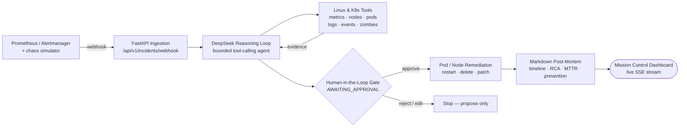

<div align="center">

# KubeAgent

### The Autonomous SRE Agent that detects, diagnoses, and fixes Linux & Kubernetes incidents in under 30 seconds.

[](https://fastapi.tiangolo.com)
[](https://kubernetes.io)
[](https://www.deepseek.com)
[](https://www.kernel.org)
[](LICENSE)
[](https://github.com/Maazkhan96271/KubeAgent)

[Quickstart](#-60-second-quickstart) · [Architecture](#-architecture) · [Deploy on VKE](#-production-deployment-vultr-kubernetes-engine) · [Security](#-security--safety-model) · [Demo script](DEMO_SCRIPT.md)

</div>

---

## Why KubeAgent exists

It is 3:04 AM. Your phone is screaming. A pod is OOMKilling in a loop, the
dashboard is a wall of red, and the first thing you do is *not* fix it — you
SSH in, `kubectl describe`, `kubectl logs --previous`, grep a runbook that was
last updated eight months ago, and hope you remember which env var the last
person changed.

KubeAgent collapses that entire loop into one agentic run: it collects the
evidence an on-call engineer would collect, reasons over it with DeepSeek,
proposes a reversible fix, waits for your approval, applies it, verifies the
cluster is healthy, and writes the post-mortem your manager will ask for on
Monday.

**Detection → diagnosis → remediation → documentation, in under 30 seconds.**

---

## Architecture



| Stage | What actually happens |
| --- | --- |
| **Ingestion** | Alertmanager webhooks, your own `POST /incidents`, or the built-in chaos simulator create an incident with severity, labels and pod context. Duplicate firing alerts are de-duplicated by fingerprint. |
| **Reasoning loop** | The agent runs a bounded tool-calling loop (`AGENT_MAX_STEPS`, default 6). No cluster mutation is possible from this stage. |
| **Tools** | Linux: CPU/memory/disk metrics, top processes, zombie detection. Kubernetes: nodes, unhealthy pods, pod logs, events, deployments. |
| **HITL gate** | The incident lands in `AWAITING_APPROVAL` with the exact commands it wants to run. Nothing executes until a human calls `/approve`. |
| **Remediation** | Approved actions only: restart/scale a deployment, delete a stuck pod. Every action is written to the incident event log. |
| **Post-mortem** | A GitHub-Flavored Markdown report (HTML view available) with the timeline, root cause, commands executed, preventive recommendations and real MTTR. |

---

## Problem vs. Solution

| | **Manual on-call at 3 AM** | **KubeAgent** |
| --- | --- | --- |
| **Time to first hypothesis** | 10–20 min of `describe` / `logs` / runbook reading | Seconds — collectors gather evidence in parallel |
| **Context switching** | SSH, three dashboards, a wiki, Slack | One agentic run, one event stream |
| **Diagnosis quality** | Depends on who is on call and how tired they are | Same reasoning path every time, every incident |
| **Remediation** | Ad-hoc `kubectl delete pod` from memory | Explicit, approved, logged commands |
| **Blast radius** | Unbounded — a typo can hit prod | RBAC-scoped, approval-gated, simulation mode available |
| **Documentation** | Written days later, if at all | Generated automatically at resolution |
| **MTTR visibility** | Guessed from chat timestamps | Measured from the event log ("14.2 seconds") |
| **Repeat incidents** | Same fire drill again | Preventive recommendations per failure signature |

---

## ⚡ 60-Second Quickstart

No cluster, no kubeconfig, no API key. Simulation mode is on by default, so the
collectors serve a deterministic incident instead of touching a real cluster.

```bash
git clone https://github.com/Maazkhan96271/KubeAgent.git && cd KubeAgent && docker compose up --build
```

Open **http://localhost:8000/** for Mission Control, then trigger an incident
from another terminal:

```bash
curl -s -X POST http://localhost:8000/api/v1/incidents/simulate \
  -H 'Content-Type: application/json' \
  -d '{"scenario":"OOMKilled_Payment_Service"}' | jq '.incident.id'
```

Watch the dashboard stream the agent's inspection live, approve the remediation
with one click, and hit **View Post-Mortem Report** once the incident flips to
`RESOLVED`.

> Prefer running from source? `pip install -r requirements.txt && cd backend && uvicorn app.main:app --reload --port 8000`.

### Optional: enable DeepSeek reasoning

```bash
export LLM_API_KEY=sk-...        # DeepSeek key; without it the agent runs rule-based
docker compose up --build
```

### Chaos scenarios

| Scenario | Signature |
| --- | --- |
| `OOMKilled_Payment_Service` | Container OOMKilled (137), 6 restarts, memory allocation leak |
| `CrashLoopBackOff_Database_Config` | Missing secret key, failing startup probe, CrashLoopBackOff |
| `Zombie_Process_Leak` | Unreaped child processes, PID table exhaustion on the host |
| `CPU_Spike_Worker_Saturation` | Node CPU saturation, throttling, probe timeouts |

Aliases work too (`"OOMKilled"`, `"CPU Spike"`, `"Config Error"`, `"zombie"`).

---

## API surface

| Method | Path | Purpose |
| --- | --- | --- |
| `POST` | `/api/v1/incidents/webhook` | Ingest Alertmanager or custom alerts |
| `POST` | `/api/v1/incidents/simulate` | Trigger a chaos scenario |
| `GET` | `/api/v1/incidents` | List incidents (`?status=OPEN`) |
| `POST` | `/api/v1/incidents/{id}/analyze` | Run the agent (synchronous) |
| `POST` | `/api/v1/incidents/{id}/approve` | Human-in-the-loop approval |
| `POST` | `/api/v1/incidents/{id}/resolve` | Close an incident manually |
| `GET` | `/api/v1/incidents/{id}/postmortem` | Markdown RCA (`?format=html` for the rendered view) |
| `GET` | `/api/v1/incidents/{id}/stream` | SSE event stream for one incident |
| `GET` | `/api/v1/stream/incidents` | SSE stream across all incidents |
| `GET` | `/healthz` | Liveness + readiness probe |

Interactive docs: **http://localhost:8000/docs**

---

## 🚀 Production deployment: Vultr Kubernetes Engine

KubeAgent ships production manifests and a Helm chart:

```
manifests/
├── 01-rbac.yaml          # namespace, ServiceAccount, least-privilege ClusterRole
├── 02-configmap.yaml     # non-sensitive config + LLM_API_KEY secret placeholder
├── 03-deployment.yaml    # hardened single-replica Deployment, /healthz probes
├── 04-service.yaml       # ClusterIP + Vultr LoadBalancer (or nginx Ingress)
├── chaos-demo-pod.yaml   # faulty pod that OOMKills itself for live demos
└── helm/kubeagent/       # equivalent Helm chart
```

One-shot install on a VKE cluster (Kubernetes 1.28+):

```bash
kubectl apply -f manifests/01-rbac.yaml
kubectl -n kubeagent create secret generic kubeagent-secrets \
  --from-literal=LLM_API_KEY="$LLM_API_KEY"
kubectl apply -f manifests/02-configmap.yaml
kubectl apply -f manifests/03-deployment.yaml
kubectl apply -f manifests/04-service.yaml
kubectl -n kubeagent rollout status deployment/kubeagent
kubectl -n kubeagent get svc kubeagent-lb -w     # wait for EXTERNAL-IP
```

Or with Helm:

```bash
helm upgrade --install kubeagent manifests/helm/kubeagent \
  --namespace kubeagent --create-namespace \
  --set image.repository=ghcr.io/<your-org>/kubeagent \
  --set secrets.llmApiKey="$LLM_API_KEY"
```

The Vultr cloud controller manager provisions the Load Balancer automatically
from the `vultr-loadbalancer-*` annotations; the dashboard and API answer on the
resulting IP.

**Full runbook:** [docs/VKE-DEPLOYMENT.md](docs/VKE-DEPLOYMENT.md) — image build,
private registry pulls, TLS via cert-manager, SSE proxy settings, live chaos
demo, upgrade/rollback and troubleshooting.

---

## 🔒 Security & Safety model

KubeAgent is designed to be safe to run next to production, and honest about
what it can do.

**Least-privilege RBAC.** The `kubeagent-reader-remediator` ClusterRole reads
pods, logs, nodes, events, namespaces, services and deployments. Its only write
verbs are `patch`/`update` on deployments and `delete` on pods. It cannot read
Secrets, exec into containers, mutate RBAC, or touch nodes' kubelets beyond
read-only stats.

**Dry-run / simulation mode.** `SIMULATION_MODE=true` swaps every collector for
the deterministic chaos simulator — the agent reasons over realistic evidence
but never contacts a cluster. This is the default for local development, so a
fresh clone cannot damage anything.

**Human-in-the-loop by default.** Analysis stops at `AWAITING_APPROVAL`. The
exact commands are shown to the operator; `/approve` is the only path that
executes remediation, and `AUTO_REMEDIATE=false` is the shipped default.

**Non-root, read-only runtime.** The image runs as UID/GID `10001` with a
read-only root filesystem, all capabilities dropped, `RuntimeDefault` seccomp and
a writable `/tmp` only. The namespace enforces the `restricted` Pod Security
Standard.

**No secret exfiltration.** The LLM key is injected from a Kubernetes Secret as
an optional env var; it is never written to logs, event history, the dashboard or
the generated post-mortem. Incident reports contain cluster evidence only.

**Auditable by construction.** Every status change, evidence item, command and
approval is appended to the incident event log with a timestamp, which is also
what produces the measured MTTR.

> ⚠️ The API ships without built-in authentication for demo clarity. Put it
> behind your ingress/WAF/VPN before exposing it publicly.

---

## Limits (what it does *not* do yet)

- Incident state is in-process (last 50) — restart loses history; run one replica.
- Remediation is limited to deployment restarts/scaling and pod deletion, not
  arbitrary runbooks.
- The LLM path is optional; without a key the agent uses rule-based heuristics.
- Single-cluster: no fleet-wide correlation yet.

Roadmap: persistent incident store (Postgres), OPA policy checks before
remediation, Slack/Teams approval, multi-cluster fleet view, and a fine-tuned
triage model for log clustering.

---

## Repository layout

```
backend/app/
├── agent/            # orchestrator, tool registry, prompts, post-mortem generator
├── api/              # incident REST + SSE routes
├── collectors/       # Linux + Kubernetes collectors, chaos simulator
├── config.py         # pydantic-settings configuration
├── main.py           # FastAPI app, /healthz, dashboard
└── templates/        # Mission Control dashboard
manifests/            # production K8s manifests + Helm chart
docs/                 # VKE deployment guide
DEMO_SCRIPT.md        # 3-minute hackathon demo script
```

---

## Built at HackGlobal 2026

Built with FastAPI, Kubernetes, DeepSeek and a lot of respect for people who
carry the pager.

**License:** [MIT](LICENSE) · **Author:** Maaz Khan (MAK)
